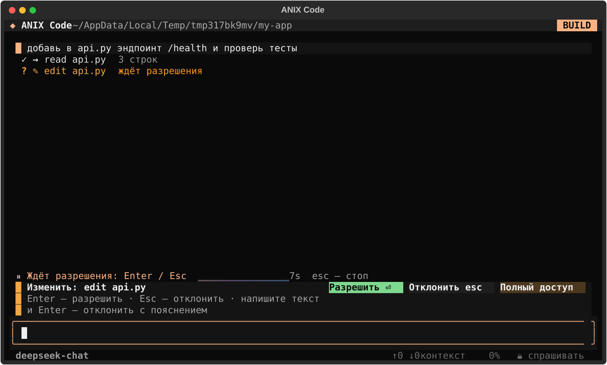

# ANIX Code

  [](https://pypi.org/project/anixcode/) 

🇬🇧 English · 🇷🇺 [Русский](README.ru.md)

> ⚠️ Early version. The main things work, but bugs are possible: please report them in Issues.

An AI coding agent for your terminal. Paste an API key from any provider, describe a task, and the agent
reads the project, edits files and runs commands by itself. Every change is shown as a diff, and nothing
is changed without your approval (unless you turn on full access).

<p align="center">
  
</p>

```
◆ ANIX Code  ~/projects/my-app                                        BUILD
 ▎ add a /health endpoint to api.py with a test
   ✓ → read api.py  84 lines
   ✓ ⌕ grep def test_  6 matches
   ✓ ✎ edit api.py  +7 −0
   ✓ $ pytest -q  → 0
 Done: added GET /health and a test in tests/test_api.py, all 7 tests pass.
```

## Install

Python 3.11+ is required.

```bash
pip install anixcode          # or: pipx install anixcode
# or for development:
git clone https://github.com/an1zy/anixcode && cd anixcode
pip install -e .
anixcode            # open in the current folder
anixcode ~/proj     # or in a specific one
```

On the first start a connection window opens: choose a provider, paste the key and press “Model list”.
Any OpenAI-compatible server works:

| Provider | Key |
|---|---|
| DeepSeek | platform.deepseek.com |
| OpenAI, Anthropic, Google Gemini, Groq | in their consoles |
| ANIX Router, Ollama, LM Studio | not needed, they run locally |
| ★ Your own providers | “＋ Own” button: name, `/v1` address, key, “Check” |

The model has to support tool calling (function calling).

If you start ANIX Code from your home folder or `C:\Windows\System32` (a fresh cmd window), it asks which
project to work in. Switch projects any time with `Ctrl+P` or by clicking the path in the header; you can
also paste a `https://github.com/...` link there to clone a repository.

The interface language follows your system (Russian or English). Switch it with `/language`.

## Usage

| Keys | |
|---|---|
| `Enter` / `Ctrl+J` | send / new line |
| `Tab` / `Shift+Tab` | **Build** (edits code) ↔ **Plan** (only reads and plans) |
| `Esc` | stop the agent |
| `Ctrl+P` | choose a project: recent, found git repositories, browse disks, clone by link |
| `F2` | full access on/off |
| `Ctrl+O` | model and key |
| `Ctrl+N` / `Ctrl+S` | new session / past sessions |
| `Ctrl+T` | theme picker with preview: ANIX (peach), Noir (black & white), Tokyo Night, Catppuccin, Dracula, Nord… |
| `F1` | help |

Click an action card to expand its diff or command output.
Logo and progress animations can be turned off in `settings.json`: `"animations": false`.

**Approvals.** When the agent wants to change a file or run a command, a line appears above the input
(the diff or the command is shown in the card in the chat): `Enter` allows, `Esc` denies, typing text and
pressing `Enter` denies and tells the agent what to do instead. Dangerous commands (`rm -rf`,
`Remove-Item -Recurse`, `del /s`, `git push --force`, `git reset --hard`…) are highlighted in red.
**Full access** (`F2` or click “🔒 ask first” at the bottom right): the agent works without asking until
you turn it off.

**@files.** Type `@` in a prompt to get suggestions of project files (↑↓, Enter or Tab). The whole file is
sent with the prompt and the agent can edit it right away: `fix the bug in @src/api.py`.
`@folder/` attaches a listing of the folder.

**Project rules.** `/init`: the agent studies the project and writes `AGENTS.md` (what the project is,
structure, build and test commands, code style). Add your own rules there, for example “tests use vitest,
don't touch the legacy folder”. The agent reads this file before every task.

**Reliability:**
- `/undo` reverts all file changes from the agent's last answer (several times in a row, also after a
  restart); `/redo` brings them back. Terminal commands (`bash`) are not undone.
- The bottom right shows how full the model context is. At 80% the history is compressed automatically:
  old command outputs are removed first, then old steps are folded into a summary. Manually: `/compact`.
- On network failures, timeouts, 429 and 5xx responses the request is retried up to 4 times.
- The context size is guessed from the model name. For your own model set it in `settings.json`:
  `"context_window": 128000`.

## Commands

Type `/` to get the list with descriptions (↑↓, `Tab` completes, `Enter` runs).
The set follows Claude Code and OpenCode.

| Command | |
|---|---|
| `/init` | study the project and write `AGENTS.md` |
| `/review [focus]` | review uncommitted changes (or the last commit) |
| `/commit [details]` | commit with a good message in the project's style |
| `/test [what]` | find and run the tests, fix failing ones |
| `/fix <error>` | fix an error from its text or a description |
| `/explain <@file>` | explain code |
| `/pr` | pull request description for the current branch |
| `/undo` / `/redo` | undo the last answer's changes / bring them back |
| `/compact` | compress the history |
| `/new`, `/clear`, `/sessions`, `/resume` | sessions |
| `/model`, `/connect` | model and key |
| `/project` | choose a project |
| `/theme`, `/mode`, `/permissions` | theme, Build/Plan, full access |
| `/status` | summary: project, model, tokens, context |
| `/export` | save the session as Markdown |
| `/doctor` | check git, ripgrep, connection to the model, AI-RPC |
| `/language` | interface language: Русский / English (after a restart) |

**Quick input:**
- `!command` runs a command in the terminal yourself, without the model; the agent sees the output:
  `!pytest -q`, then “fix it”.
- `# text` saves a rule to `AGENTS.md`: `# use pnpm, not npm`.

**Own commands.** A Markdown file in `.anixcode/commands/name.md` (this project) or in
`%APPDATA%\anixcode\commands\name.md` / `~/.config/anixcode/commands/name.md` (all projects) becomes the
command `/name`. `$ARGUMENTS` is replaced with everything after the command, `$1`, `$2` with single words.
An example is in `.anixcode/commands/check.md`:

```markdown
---
description: run the project tests and show the result
---
Run `pytest -q`. If tests fail, show the failing test names and the short reason for each. $ARGUMENTS
```

Prompt commands also work without the interface: `anixcode run "/review"`.

**Without the interface:**
```bash
anixcode run "find where the discount is calculated and explain it" --plan
anixcode run "fix the failing test" -y      # -y: allow everything without asking
anixcode connect                             # connect a model from the console
anixcode models                              # list the provider's models
```

## Tools

| Tool | |
|---|---|
| `read` | reads a file with line numbers, big files in parts |
| `ls`, `glob` | folder tree, find files by pattern |
| `grep` | search in code (ripgrep if installed) |
| `edit` | precise text replacement; the file must have been read and not changed since |
| `write` | new file or full rewrite |
| `bash` | commands: tests, git, builds (PowerShell on Windows) |

File tools never leave the project folder. Edits and commands need approval unless full access is on.
Fine-tuning in `settings.json`: `"permissions": {"edit": "ask", "exec": "ask"}` (`ask` / `allow` / `deny`).

**AI-RPC.** If [AI-RPC](https://github.com/an1zy/ai-rpc) is running, Discord shows “ANIX Code · Generating”.

## Updates and keys

Keys and settings are stored **outside the code folder**, so you can unpack a new version over the old one
or into another folder: keys, own providers and sessions stay. To move to another computer, copy the whole
folder below.

`%APPDATA%\anixcode\` (Windows) or `~/.config/anixcode/`:
- `settings.json`: provider, model, theme, permissions, language;
- `auth.json`: API keys (only on your computer, readable only by your user);
- `sessions.db`: session history.

## Development

```bash
pip install -e ".[dev]" && pytest
```

Translations: interface strings are written in Russian in the code as `tr("…")`; English versions live in
`anixcode/i18n_en.py` (a test checks that every string has one).

```
anixcode/
  llm.py          OpenAI-compatible API client: streaming, tool calls, readable errors, retries
  agent.py        the agent loop, approvals, Build/Plan modes, undo/redo
  tools/          read, ls, glob, grep, edit, write, bash
  prompts.py      system prompt + AGENTS.md
  storage.py      sessions and file snapshots in SQLite
  checkpoints.py  file snapshots for /undo
  compaction.py   history compression to fit the context
  danger.py       spotting dangerous commands
  mentions.py     @files: suggestions and attaching
  commands.py     /commands: built-in, ready-made prompts, own ones from .md
  i18n.py         Russian / English interface
  providers.py    provider list
  tui/            the Textual interface
```

## Roadmap

- [x] Undo (`/undo`, `/redo`)
- [x] History compression, retries on failures
- [x] `@file` in prompts, `/init`, dangerous-command highlighting
- [x] `/review`, `/commit`, `/test`…, own commands from `.md`, `!` and `#`
- [x] English interface
- [ ] MCP servers
- [ ] Several agents in parallel
- [ ] Desktop version
