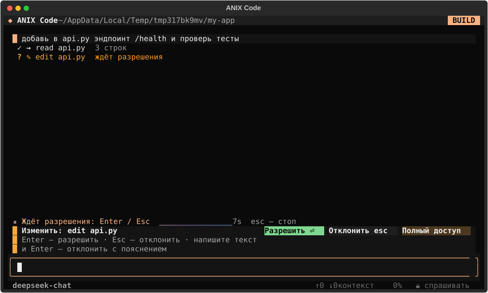

# ANIX Code

  [](https://pypi.org/project/anixcode/) 

🇬🇧 [English](README.md) · 🇷🇺 Русский

> ⚠️ Ранняя версия. Основное работает, но баги возможны: пишите в Issues.

ИИ-агент для кода прямо в терминале. Вставляете API-ключ любого провайдера, пишете задачу,
а агент сам читает проект, правит файлы и запускает команды. Каждое изменение показывается
как diff, и без вашего разрешения ничего не меняется.

<p align="center">
  
</p>

```
◆ ANIX Code  ~/projects/my-app                                        BUILD
 ▎ добавь в api.py эндпоинт /health и тест к нему
   ✓ → read api.py · 84 строк
   ✓ ⌕ grep def test_ · 6
   ✓ ✎ edit api.py  +7 −0
   ✓ $ pytest -q  → 0
 Готово: добавил GET /health, тест в tests/test_api.py, все 7 тестов проходят.
```

## Установка

Нужен Python 3.11+.

```bash
pip install anixcode          # или: pipx install anixcode
# или для разработки:
git clone https://github.com/an1zy/anixcode && cd anixcode
pip install -e .
anixcode            # открыть в текущей папке
anixcode ~/proj     # или в нужной
```

Если запустить из домашней папки или из `C:\Windows\System32` (новое окно cmd), ANIX Code сам
спросит, в каком проекте работать. Сменить проект можно в любой момент: `Ctrl+P` или клик по пути
в шапке. Туда же можно вставить ссылку `https://github.com/...`, и репозиторий склонируется.

При первом запуске откроется окно подключения. Там выбираете провайдера, вставляете ключ
и нажимаете «Список моделей». Подходит любой OpenAI-совместимый сервер:

| Провайдер | Ключ |
|---|---|
| DeepSeek | platform.deepseek.com |
| OpenAI, Anthropic, Google Gemini, Groq | в их консолях |
| ANIX Router, Ollama, LM Studio | не нужен, работают локально |
| ★ Свои провайдеры | кнопка «＋ Свой» в окне подключения: название, адрес `/v1`, ключ, «Проверить» |

Модель должна поддерживать вызов инструментов (tools / function calling).

## Как пользоваться

| Клавиши | |
|---|---|
| `Enter` / `Ctrl+J` | отправить / новая строка |
| `Tab` | **Build** (правит код) ↔ **Plan** (только читает и планирует) |
| `Esc` | остановить агента |
| `Ctrl+P` | выбрать проект: недавние, найденные git-репозитории, обзор папок, клон по ссылке |
| `Ctrl+O` | модель и ключ |
| `Ctrl+N` / `Ctrl+S` | новая сессия / прошлые сессии |
| `Ctrl+T` | выбор темы с предпросмотром: ANIX (персиковая), Noir (чёрно-белая), Tokyo Night, Catppuccin, Dracula, Nord… |
| `F1` | помощь |

Клик по карточке действия разворачивает diff или вывод команды.

**Надёжность:**
- `/undo` откатывает все правки файлов из последнего ответа агента. Можно вызывать несколько раз
  подряд, работает и после перезапуска. Команды в терминале (`bash`) не откатываются.
- Внизу справа видно, на сколько заполнен контекст модели. При 80% история сжимается сама:
  сначала убираются старые выводы команд, потом старые шаги сворачиваются в сводку. Вручную: `/compact`.
  Если модель всё равно ответит «слишком длинно», агент сожмёт историю и повторит запрос.
- При сбоях сети, таймаутах, ответах 429 и 5xx запрос повторяется до 4 раз с паузой 1.5–12 с.
- Размер контекста угадывается по названию модели. Для своей модели укажите его в `settings.json`:
  `"context_window": 128000`.
Анимации логотипа и индикатора работы выключаются в `settings.json`: `"animations": false`.

**@файлы.** Напишите `@` в запросе, и появятся подсказки по файлам проекта (↑↓, Enter или Tab).
Файл целиком уходит модели вместе с запросом, и агент может сразу его править: `почини баг в @src/api.py`.
`@папка/` прикрепляет список её содержимого.

**Правила проекта.** `/init`: агент сам изучит проект и напишет `AGENTS.md` (что за проект, структура,
команды сборки и тестов, стиль кода). Файл можно дописать своими правилами, например «тесты через
vitest, не трогай папку legacy». Агент читает его перед каждой задачей.

**Разрешения.** Когда агент хочет изменить файл или выполнить команду, над полем ввода появляется
строка с действием (diff или команда видны в карточке в чате):
`Enter` — разрешить, `Esc` — отклонить, напишите текст и `Enter` — отклонить и объяснить агенту, как надо.
Опасные команды (`rm -rf`, `Remove-Item -Recurse`, `del /s`, `git push --force`, `git reset --hard`…)
подсвечиваются красным. **Полный доступ** (`F2` или клик по «🔒 спрашивать» внизу справа): агент работает
без вопросов, пока вы его не выключите.

## Команды

Наберите `/`, и появится список с описаниями (↑↓, `Tab` — дописать, `Enter` — выполнить).
Набор взят у Claude Code и OpenCode.

| Команда | |
|---|---|
| `/init` | изучить проект и написать `AGENTS.md` |
| `/review [фокус]` | ревью незакоммиченных изменений (или последнего коммита) |
| `/commit [уточнения]` | закоммитить с хорошим сообщением в стиле проекта |
| `/test [что]` | найти и запустить тесты, починить падающие |
| `/fix <ошибка>` | починить ошибку по тексту или описанию |
| `/explain <@файл>` | объяснить код |
| `/pr` | описание pull request для текущей ветки |
| `/undo` / `/redo` | откатить правки последнего ответа / вернуть их |
| `/compact` | сжать историю |
| `/new`, `/clear`, `/sessions`, `/resume` | сессии |
| `/model`, `/connect` | модель и ключ |
| `/project` | выбрать проект |
| `/theme`, `/mode`, `/permissions` | тема, Build/Plan, полный доступ |
| `/status` | сводка: проект, модель, токены, контекст |
| `/export` | сохранить сессию в Markdown |
| `/doctor` | проверить git, ripgrep, подключение к модели, AI-RPC |
| `/mcp [add|remove|on|off|tools|reload]` | MCP-серверы: список, добавить, удалить, вкл/выкл, инструменты, перезапуск |
| `/language` | язык интерфейса: русский / English (после перезапуска) |

**Быстрый ввод:**
- `!команда`: выполнить команду в терминале самому, без модели. Агент увидит вывод: `!pytest -q`, потом «почини».
- `# текст`: записать правило в `AGENTS.md`: `# используй pnpm, а не npm`.
- `Shift+Tab` (или `Tab`): Build / Plan.

**Свои команды.** Markdown-файл в `.anixcode/commands/имя.md` (только этот проект) или в
`%APPDATA%\anixcode\commands\имя.md` (все проекты) становится командой `/имя`. `$ARGUMENTS` в тексте
заменяется на всё после команды, `$1`, `$2` на отдельные слова. Пример лежит в `.anixcode/commands/check.md`:

```markdown
---
description: прогнать тесты проекта и показать итог
---
Run `pytest -q`. If tests fail, show the failing test names and the short reason for each. $ARGUMENTS
```

Команды-запросы работают и без интерфейса: `anixcode run "/review"`.

**Без интерфейса:**
```bash
anixcode run "найди, где считается скидка, и объясни" --plan
anixcode run "почини падающий тест" -y      # -y: разрешать всё без вопросов
anixcode connect                             # подключить модель из консоли
anixcode models                              # список моделей провайдера
```

## Что умеет агент

| Инструмент | |
|---|---|
| `read` | читает файл с номерами строк, большие по частям |
| `ls`, `glob` | дерево папок, поиск файлов по маске |
| `grep` | поиск по коду (ripgrep, если установлен) |
| `edit` | точечная замена текста. Требует, чтобы файл был прочитан и не менялся с тех пор |
| `write` | новый файл или полная перезапись |
| `bash` | команды: тесты, git, сборка (PowerShell на Windows) |

Файловые инструменты не выходят за папку проекта. Правки и команды требуют разрешения, если не
включён полный доступ. Тонкая настройка в `settings.json`: `"permissions": {"edit": "ask", "exec": "ask"}`
(значения `ask` / `allow` / `deny`).

**AI-RPC.** Если запущен AI-RPC, в Discord сам показывается статус «ANIX Code · Generating».

## Обновление и ключи

Ключи и настройки хранятся **не в папке с кодом**, а в папке пользователя (ниже). Поэтому новую
версию можно распаковать поверх старой или в другую папку: ключи, свои провайдеры и сессии останутся
на месте. Хотите перенести на другой компьютер — скопируйте эту папку целиком.

## Где что лежит

`%APPDATA%\anixcode\` (Windows) или `~/.config/anixcode/`:
- `settings.json`: провайдер, модель, тема, разрешения;
- `auth.json`: API-ключи (только на вашем компьютере, доступ только у вашего пользователя);
- `sessions.db`: история сессий.

## Разработка

```bash
pip install -e ".[dev]" && pytest
```

## MCP-серверы

Добавить сервер можно через команду `/mcp add` или прямо в `settings.json` (формат такой же, как `mcpServers` в Claude Desktop и Cursor):

```json
"mcp_servers": {
  "github":   {"command": "npx", "args": ["-y", "@modelcontextprotocol/server-github"],
               "env": {"GITHUB_PERSONAL_ACCESS_TOKEN": "${GITHUB_TOKEN}"}},
  "context7": {"url": "https://mcp.context7.com/mcp"},
  "big":      {"command": "uvx", "args": ["some-server"], "tools": ["search"], "timeout": 300},
  "old":      {"command": "...", "disabled": true}
}
```

- `command` + `args` + `env`: локальный сервер (stdio), запускается в папке проекта.
- `url` + `headers`: удалённый сервер (Streamable HTTP).
- `${VAR}` подставляется из переменных окружения, чтобы не хранить токены в файле.
- `tools`: оставить только нужные инструменты (экономит контекст). `timeout`: секунды на вызов (по умолчанию 120).
- Модель видит их как `mcp__<сервер>__<инструмент>`. Они запрашивают разрешение так же, как правки файлов; `"permissions": {"mcp": "allow"}` отключает запрос.
- `/mcp`, `/status` и `/doctor` показывают подключённые серверы.

```
anixcode/
  llm.py          клиент OpenAI-совместимого API: стриминг, tool calls, понятные ошибки
  agent.py        цикл агента, разрешения, режимы Build/Plan
  tools/          read, ls, glob, grep, edit, write, bash
  mcp.py          клиент MCP (stdio + Streamable HTTP)
  prompts.py      системный промпт + AGENTS.md
  storage.py      сессии и снимки файлов в SQLite
  checkpoints.py  снимки файлов для /undo
  danger.py       распознавание опасных команд
  mentions.py     @файлы: подсказки и прикрепление
  commands.py     /команды: встроенные, готовые запросы, свои из .md
  compaction.py   сжатие истории под размер контекста
  providers.py    список провайдеров
  tui/            интерфейс на Textual
```

## Планы

- [x] Откат правок (`/undo`)
- [x] Сжатие длинной истории, повторы при сбоях
- [x] `@файл` в запросе, `/init` для AGENTS.md, предупреждения об опасных командах
- [x] Команды `/review`, `/commit`, `/test`…, свои команды из `.md`, `!` и `#`
- [x] MCP-серверы
- [ ] Несколько агентов параллельно
- [ ] Десктоп-версия
